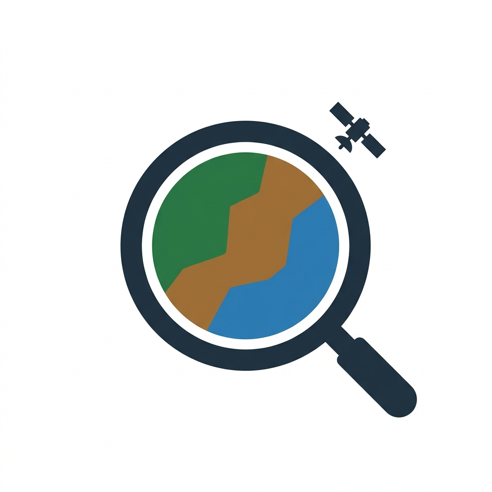
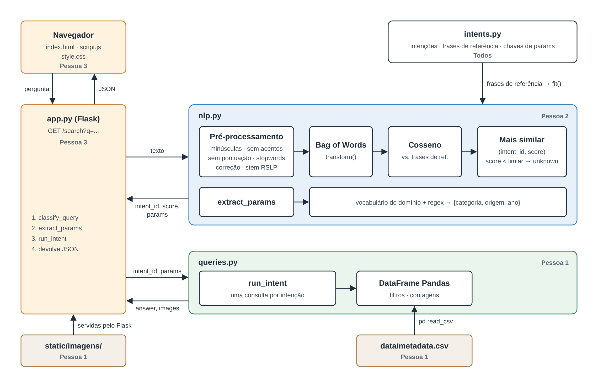

<p align="center">
  
</p>

# PC.6 — Busca semântica de imagens de sensoriamento remoto

Trabalho prático PC.6 da disciplina de Processamento de Linguagem Natural (Prof. Fabrício Galende Marques de Carvalho).

Motor de busca em linguagem natural sobre um catálogo de imagens de sensoriamento remoto. O usuário digita uma pergunta, o sistema a representa como **Bag of Words**, compara com frases de referência por **similaridade de cosseno** e, de acordo com a frase de referência mais similar, executa a consulta correspondente em um **DataFrame Pandas** carregado de um arquivo CSV.

**Stack:** Python 3, Flask, Pandas, scikit-learn e NLTK.

## Como executar

```bash
python3 -m venv .venv
source .venv/bin/activate
pip install -r requirements.txt
python app.py
```

Depois, abra http://127.0.0.1:5000 no navegador.

## Arquitetura



O diagrama editável está em [`docs/arquitetura.svg`](docs/arquitetura.svg).

## Fluxo de uma busca

```
pergunta do usuário
  → classify_query(text)            → (intent_id, score)
  → extract_params(text)            → params
  → run_intent(intent_id, params)   → resposta + imagens
  → exibição na página
```

## Intenções

Definidas em `intents.py`. Toda intenção aplica os parâmetros presentes na pergunta (`categoria`, `origem`, `ano`); por isso "quantas imagens?" e "quantas imagens de água?" são a mesma intenção.

| Intenção | Exemplo de pergunta | Consulta Pandas | Resposta |
|---|---|---|---|
| `count_images` | "Quantas imagens estão catalogadas?" | `len(df)` | "No total, há 23 imagens cadastradas." |
| `count_images` | "Quantas imagens de água há?" | `len(df[df["categoria"] == "água"])` | "Há 8 imagens de água." |
| `list_images` | "Quais imagens possuem vegetação?" | `df[df["categoria"] == "vegetação"]` | "Encontrei 7 imagens de vegetação." + galeria |
| `count_by_category` | "Quantas imagens há de cada categoria?" | `df["categoria"].value_counts()` | "Imagens, por categoria — água: 8 imagens; ..." |
| `count_by_origin` | "Quantas imagens vieram de cada origem?" | `df["origem"].value_counts()` | "Imagens, por origem — drone: 12 imagens; ..." |

## Estrutura e responsáveis

| Arquivo | Responsável | Conteúdo |
|---|---|---|
| `intents.py` | Pessoa 1 | Intenções, frases de referência (8 a 10 por intenção), chaves de `params` e valores válidos. Usado também pela Pessoa 2; alterar só em acordo com o grupo. |
| `data/metadata.csv` | Pessoa 1 | Catálogo das imagens. |
| `data/fontes.csv` | Pessoa 1 | Origem, autor e licença de cada imagem. |
| `static/imagens/` | Pessoa 1 | Arquivos das imagens (reais). |
| `queries.py` | Pessoa 1 | `run_intent`: uma consulta Pandas por intenção. |
| `nlp.py` | Pessoa 2 | `classify_query` e `extract_params`: pré-processamento, correção de digitação, BOW e cosseno. |
| `app.py` | Pessoa 3 | Servidor Flask com as rotas `/` (página) e `/search` (JSON). |
| `templates/index.html`, `static/script.js`, `static/style.css` | Pessoa 3 | Página única: campo de busca, resposta e galeria de imagens. |
| `requirements.txt`, `README.md` | Pessoa 3 | Dependências e documentação. |
| `docs/arquitetura.svg`, `docs/arquitetura.png` | Pessoa 3 | Diagrama da arquitetura (editar o SVG e regenerar o PNG). |
| `static/logo.png` | — | Logo do projeto. |

## Base de metadados

Arquivo `data/metadata.csv`, uma linha por imagem:

| Coluna | Conteúdo | Exemplo |
|---|---|---|
| `arquivo` | Caminho relativo à raiz do projeto | `static/imagens/agua_drone_01.png` |
| `categoria` | `vegetação`, `solo exposto` ou `água` | `água` |
| `data` | Data da imagem no formato `dd/mm/yyyy` | `12/08/2024` |
| `origem` | `satélite` ou `drone` | `drone` |

O catálogo tem 23 imagens reais do [Wikimedia Commons](https://commons.wikimedia.org): 7 de vegetação, 8 de água e 8 de solo exposto, metade de drone e metade de satélite (Sentinel-2, MODIS/NASA, Planet Labs, Axelspace). As datas vêm dos metadados originais de cada imagem. Título, página, autor e licença de cada uma estão em `data/fontes.csv`; as licenças são domínio público, CC0, CC BY e CC BY-SA, e exigem atribuição ao autor.

## Contrato entre os módulos

### `classify_query(text) -> (intent_id, score)` — `nlp.py`

- O vetorizador BOW é ajustado (`fit`) **somente** nas frases de referência de `intents.py`. Na pergunta do usuário usa-se `transform`, nunca `fit_transform`.
- A pergunta é comparada por similaridade de cosseno com cada frase de referência. A intenção é a da **frase de referência mais similar**, como pede o enunciado.
- `score` é o **cosseno dessa frase mais similar**.
- Se o score ficar abaixo do limiar, ou se o vetor da pergunta for todo zero, retorna `"unknown"`. O limiar deve ser calibrado com perguntas de teste.

### `extract_params(text) -> dict` — `nlp.py`

- Retorna um dicionário com todas as chaves de `params` definidas em `intents.py`, por exemplo `{"categoria": "água", "origem": "drone", "ano": 2024}`. `ano` é um inteiro.
- Os valores de `categoria` e `origem` devem ser escritos exatamente como no CSV (com acento): `"solo exposto"`, `"satélite"`.
- As chaves usam os mesmos nomes das colunas do CSV.
- Parâmetro não mencionado na pergunta vem como `None`.

### `run_intent(intent_id, params) -> dict` — `queries.py`

- Retorna `{"answer": str, "images": [...]}`. Cada imagem traz as colunas do CSV; a lista vem da mais recente para a mais antiga.
- `"unknown"` responde "Não entendi a pergunta. Tente reformular."
- Valor de `categoria` ou `origem` que não existe no catálogo responde com as opções válidas (por exemplo, "Não conheço categoria 'floresta'. Opções: vegetação, solo exposto, água.").
- Se faltar um parâmetro obrigatório da intenção, responde perguntando qual valor o usuário deseja. Hoje nenhuma intenção tem parâmetro obrigatório.

## Convenções

- Nomes de variáveis e funções em **inglês**.
- Comentários e docstrings **sucintos**, em **português**.
- Dados, colunas do CSV, interface e documentação em **português**.

## Requisitos do enunciado

- Aplicação de página única com Python, Flask e Pandas.
- Metadados armazenados em arquivo `.csv`; consultas feitas sobre o DataFrame correspondente.
- Pipeline de PLN estudada em aula, com representação Bag of Words e similaridade de cosseno.
- Robustez a erros de digitação.
- Entregáveis: apresentação, código-fonte, procedimento de execução e `requirements.txt`.

**Prazo de entrega:** 16/11/2026.
